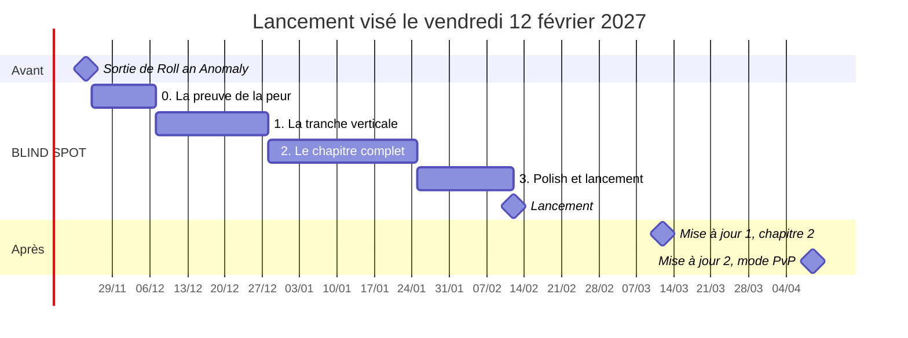

# BLIND SPOT : le plan

6 novembre 2026 · Adrien Moncade · version vivante : [doc Claude](https://claude.ai/artifact/VMZVexNFcuM3uneHSmL6jm) (ce fichier en est l'export)

## 1. Le pitch

BLIND SPOT est un jeu d'horreur Roblox en première personne, solo ou en coop de 1 à 4, où la seule chose qui te protège, c'est l'œil d'une caméra. Tu fais la ronde de nuit dans un bâtiment fermé au décor photoréaliste. Quelque chose y vit : l'Invisible, qui ne peut exister que là où aucune caméra ne regarde.

Tant qu'une caméra active te voit, il ne peut pas te toucher. Quand le courant lâche, les caméras meurent une à une et les angles morts grandissent. Ta nuit, c'est de finir ta ronde en passant d'un champ de caméra à l'autre.

**La règle sur la miniature :** « Stay on camera. Something lives in the blind spots. »

**La peur signature :** l'Invisible se voit à l'œil nu, jamais à l'écran. Lève ton caméscope : le couloir est vide et tu es à l'abri. Baisse-le : il est là, plus proche qu'avant.

### Les cinq piliers

1. **L'attente fait plus peur que le sursaut.** Peu de jumpscares, beaucoup de silence, de signes et de fausses alertes.
2. **Le réel rend l'étrange crédible.** Décors photoréalistes, rien de blocky : un stationnement qui ressemble à un vrai stationnement fait plus peur qu'un bloc gris.
3. **Une règle qui se lit en 3 secondes.** Dans le champ d'une caméra : vivant. Dans l'angle mort : proie.
4. **Terrifiant seul, mieux à plusieurs.** Le jeu se finit en solo ; en coop, filmer un coéquipier lui sauve la vie.
5. **Chaque mort se comprend.** Tu sais toujours quelle caméra est tombée et pourquoi tu étais à découvert.

### En bref

|  |  |
| --- | --- |
| Format | Première personne, solo ou coop de 1 à 4 joueurs |
| Une partie | Une nuit de 12 à 18 minutes, rejouable |
| Plateformes | Téléphone d'abord (844 × 390), puis PC et console |
| Titre sur Roblox | BLIND SPOT \[Stay on Camera\] |
| Langue du jeu | Anglais au lancement, français ensuite |
| Ce qui est neuf | Aucun jeu Roblox trouvé ne fait du champ d'une caméra la zone sûre (recherche du 4 novembre) |

## 2. L'ambiance : le plus inquiétant possible

La peur qui dure vient de l'incertitude et de l'attente, pas du choc. BLIND SPOT fait peur avec ce que le joueur ne voit pas encore, avec les sons qui s'arrêtent, et avec un lieu banal qui change dès qu'on lui tourne le dos.

### Ce que les meilleurs jeux d'horreur nous apprennent

- **Le rythme de Left 4 Dead.** Montée, pic de 3 à 5 s, retombée, puis 30 à 45 s de répit ; le directeur règle la fréquence des pics, pas leur force ([Valve, 2009](https://steamcdn-a.akamaihd.net/apps/valve/2009/ai_systems_of_l4d_mike_booth.pdf)). Chez nous : LIVE est le répit, FLICKER la montée, BLACKOUT le pic.
- **Le monstre d'Alien: Isolation ne triche jamais.** Il chasse avec ses sens, et une jauge de menace l'éloigne quand la tension a trop duré ([Game Developer](https://www.gamedeveloper.com/design/the-perfect-organism-the-ai-of-alien-isolation)). Chez nous : le directeur règle les phases, jamais les règles de l'Invisible.
- **Frictional cache ses règles.** Ne pas montrer les chiffres empêche le joueur de se sentir en sécurité ([Game Developer](https://gamedeveloper.com/design/four-ways-to-design-for-horror-from-i-amnesia-i-dev-frictional-games)). Chez nous : aucun compte à rebours avant un blackout, seulement les néons et les LED.
- **P.T. et les boucles.** Un couloir qui revient avec de petits changements inquiète plus qu'un monstre ([BFI](https://www.bfi.org.uk/features/pt-10-years-hideo-kojima-guillermo-del-toros-horror-micro-masterpiece)). Chez nous : le P2 et le P3 presque identiques, et les objets déplacés.

### Le malaise par couches

| Couche | Comment on la bâtit |
| --- | --- |
| Le lieu | Réaliste et banal : un stationnement qu'on a déjà vu. L'étrange marche parce que tout le reste est vrai |
| La lumière | Néons froids qui bourdonnent, zones éteintes, sorties de secours vertes, LED rouges. Jamais un noir total sans une lueur à viser |
| Le son | Le bourdonnement et la ventilation font le fond ; quand ils se taisent, quelque chose est là (section 8) |
| Le doute | Des objets qui bougent hors champ, une radio qui ment, des cassettes qui contredisent le cahier de bord |
| L'écran | Le caméscope ment par omission : à l'écran, le couloir est vide |
| La solitude | En coop, chaque mort retire un joueur au poste ; les vivants se sentent plus seuls à chaque perte |

### Les règles d'ambiance

- **Pas de musique pendant la ronde.** Seulement les sons du lieu ; la musique attend la fin de la nuit.
- **Un jumpscare par nuit au plus,** jamais au même endroit, toujours précédé d'un signe.
- **Des fausses alertes :** un FLICKER sur cinq ne mène à rien, et des pas qui ne sont que la ventilation.
- **Presque pas d'interface.** Ni barre de vie ni minicarte : la ronde est sur une planchette, l'heure sur la montre du personnage.
- **Le jour est la récompense.** À 6 h, la lumière grise qui descend la rampe du stationnement termine la nuit.

### Confort et accessibilité

- **Le corps du joueur d'abord.** Balancement de tête et tremblement de caméra réglables de 0 à 100 %, et un champ de vision réglable ([Xbox, guide 117](https://learn.microsoft.com/en-us/gaming/accessibility/xbox-accessibility-guidelines/117)).
- **Jamais plus de 3 flashs par seconde** pendant les FLICKER et la mort, et une option « Réduire les flashs » ([WCAG 2.3.1](https://www.w3.org/WAI/WCAG22/Understanding/three-flashes-or-below-threshold.html)).
- **Sous-titres des sons qui comptent** (pas, moteur de caméra, silence soudain) et le point REC en option (section 3).

## 3. La boucle de jeu

Une partie est une nuit de 12 à 18 minutes : tu prends ton poste, tu fais ta ronde et tu tiens jusqu'à 6 h. Pendant ce temps, le courant suit un cycle de trois phases qui s'accélère. Tous les chiffres ci-dessous sont des départs : ils vivent dans la config et se règlent au simulateur.

### Une nuit, étape par étape

1. **Prise de poste (1 min).** Le poste de sécurité, le mur d'écrans, la liste de la ronde. C'est le seul endroit toujours filmé.
2. **La ronde.** 4 à 6 tâches tirées dans la liste du lieu : relancer un disjoncteur, scanner une borne de ronde, remplacer le fusible d'une caméra, fermer une porte coupe-feu, récupérer une cassette.
3. **Le cycle du courant** tourne pendant toute la ronde (tableau ci-dessous).
4. **6 h.** La dernière tâche ramène le jour. Écran de fin : la paie de la nuit, les cassettes trouvées, les morts.

### Les trois phases

| Phase | Caméras actives | Ce que tu fais | Durée, début → fin de nuit |
| --- | --- | --- | --- |
| LIVE | Presque toutes | La ronde. L'Invisible rôde dans les rares angles morts | 90 s → 50 s |
| FLICKER | Les lumières vacillent ; la LED REC rouge reste allumée seulement sur les caméras qui tiendront | Repérer une LED rouge et courir dans son champ | 8 s → 5 s |
| BLACKOUT | 1 à 3 par zone, plus ton caméscope | Rester dans un champ ou passer d'un champ à l'autre | 15 s → 45 s |

Un FLICKER sur cinq est une fausse alerte : les lumières reviennent sans blackout. Ça garde le joueur sur ses gardes sans l'épuiser.

### Savoir si une caméra te voit, sans interface

- **La caméra te suit.** Une caméra qui te voit pivote lentement vers toi, avec le petit bruit de son moteur.
- **Le silence te trahit.** Hors de tout champ, le son se ferme : bruit de fond étouffé, ta respiration plus présente. Le silence veut dire que tu es à découvert.
- **Accessibilité.** Une option affiche un petit point REC au bord de l'écran quand tu es filmé.

### Le caméscope

- **Ta seule lumière dans le noir.** Son écran montre la scène en vision nocturne infrarouge.
- **Ce qu'il filme est vu.** L'Invisible ne peut pas exister dans son cadre.
- **Batterie limitée.** Environ 90 s d'enregistrement au départ, des piles à trouver pendant la ronde.
- **Le prix.** À travers l'écran, tu ne vois jamais l'Invisible : tu es à l'abri, mais tu ne sais plus où il est.
- **En solo,** tu le poses sur un trépied ou une tablette pour créer un champ temporaire, puis tu fais ta tâche dedans.
- **En coop,** filmer un coéquipier coincé dans un angle mort lui sauve la vie.

### Coop de 1 à 4

- **Une nuit partagée.** Plus de joueurs veut dire plus de tâches et un Invisible plus agressif (config).
- **Les morts jouent encore.** Un joueur pris se réveille au poste de sécurité : il voit le mur d'écrans, fait pivoter une caméra à la fois vers un coéquipier et signale les dangers.
- **Ramener un mort.** Rapporter son badge au poste le ramène en jeu, une fois par nuit et par joueur.
- **Se coordonner.** Beaucoup de joueurs ne peuvent pas se parler (section 10) : pings sur les caméras et le décor, roue de messages, et la voix de proximité en bonus.

### Solo

- **Tout se fait seul.** Le trépied remplace le coéquipier.
- **Mourir en solo.** La nuit reprend à la dernière tâche finie, et tu gardes les cassettes trouvées.

### D'une nuit à l'autre

- **Un chapitre = un lieu, cinq nuits.** Chaque nuit ajoute une règle : nuit 1 sans blackout, nuit 2 les premiers FLICKER, nuit 3 les blackouts, nuit 4 les câbles de caméras arrachés, nuit 5 la finale.
- **Après la nuit 5.** Des nuits aléatoires avec modificateurs, et le mode Nuit blanche, plus dur.
- **La paie.** La monnaie gagnée en jouant achète des cosmétiques et des améliorations douces (batterie un peu plus longue, trépied). Rien qui enlève la peur.

## 4. L'Invisible

L'Invisible (en jeu : *the Unseen*) n'existe que dans l'espace qu'aucune caméra ne regarde. Dès qu'un champ de caméra le touche, il cesse d'exister à cet endroit et revient ailleurs, hors de vue. Ses règles ne changent jamais : c'est le contrat avec le joueur.

### Ses règles

1. **Jamais dans un champ.** Il ne peut ni entrer ni rester dans le champ d'une caméra active ou d'un caméscope qui filme.
2. **Tes yeux ne comptent pas.** Tu peux le voir dans le noir, et il avance quand même.
3. **Jamais à l'écran.** Sur le mur d'écrans et dans le caméscope, l'endroit où il se tenait est vide.
4. **Il voyage par l'ombre.** Il se déplace seulement par de l'espace non regardé. Un angle mort entouré de champs est une île : il ne peut pas l'atteindre. Les blackouts relient les îles entre elles.
5. **Il tue au contact,** et seulement dans un angle mort.

### Ses signes

- **Les choses bougent quand personne ne regarde.** Une chaise tournée vers toi, une porte entrouverte, un chariot déplacé : il est passé par là.
- **Le bruit meurt autour de lui.** Le bourdonnement des néons et la ventilation se taisent dans un rayon autour de lui.
- **Les néons grésillent** quand il passe dessous.
- **Une trace sur la bande.** Dans le caméscope, une ligne de distorsion VHS reste au bord du cadre là où il vient de disparaître.
- **On le voit de loin.** En LIVE, il se montre parfois au bout d'un couloir sombre, immobile, puis n'y est plus.

### Son comportement

- **Un directeur règle la pression.** Comme dans Left 4 Dead ou Alien: Isolation, un système alterne traque et répit selon le stress des joueurs (temps à découvert, poursuites récentes, morts). Après une poursuite, il laisse respirer.
- **LIVE :** il rôde, déplace des objets, se montre de loin.
- **FLICKER :** il se rapproche du joueur le plus exposé.
- **BLACKOUT :** il chasse le joueur le plus longtemps hors champ et le plus loin d'une caméra.
- **Il ne triche jamais.** Le serveur calcule ce qui est regardé, et le doute profite au joueur : avec du lag, un joueur au bord d'un champ compte comme filmé.
- **Toujours une chance.** Quand il commence une chasse, le son meurt 1,5 s avant qu'il soit à portée.

### La mort

- **Deux secondes.** L'image se fige, la bande VHS déraille, une main entre dans le cadre, noir. Pas de sang, pas de gore.
- **L'avis de disparition.** Pour le reste de la nuit, un avis « Missing » avec l'avatar du joueur pris apparaît sur un babillard du bâtiment.

### À quoi il ressemble

Une silhouette qu'on croit voir du coin de l'œil : trop grande, trop mince, la tête trop penchée, sans traits nets. On ne le voit jamais en pleine lumière ; plus on le fixe, moins il est net. Le modèle est réaliste mais presque toujours dans l'ombre, ce qui garde son coût en polygones bas. Sa forme exacte est une décision pour Adrien (section 13).

## 5. Les lieux

On lance avec un seul chapitre fini et poli : le sous-sol du Halloway, du P1 au P4. C'est le lieu où le réalisme coûte le moins cher : quelques matériaux répétés (béton, peinture de sol, acier, néons), des niveaux presque identiques, des caméras qui ont leur place et des angles morts partout.

### Chapitre 1 : le sous-sol

| Zone | Ce qu'on y trouve | Son rôle |
| --- | --- | --- |
| P1 : poste de sécurité et hall des ascenseurs | Mur d'écrans, magnétoscope, cahier de bord, casiers | La base toujours filmée, où on lit les cassettes |
| P2 et P3 : stationnement | Piliers, rampes, places numérotées, voitures abandonnées, bornes de ronde | La ronde ; les angles morts derrière les piliers et les voitures |
| Corridors de service | Portes coupe-feu, tuyaux, chariots, monte-charge | Passages étroits avec peu de caméras |
| P4 : salle électrique et chaufferie | Disjoncteurs, génératrice, un mur de plâtre neuf | Les tâches de courant, puis la finale |

Le P2 et le P3 sont presque identiques, à trois détails près. La répétition désoriente le joueur, et le même kit sert deux fois.

### Les chapitres suivants

| Chapitre | Lieu | Ce qu'il ajoute |
| --- | --- | --- |
| 2 | Le hall et les bureaux : lobby, aire ouverte, salle des serveurs | Des caméras pivotantes qu'on commande depuis le poste |
| 3 | La galerie : centre commercial fermé, escaliers mécaniques, mannequins | Les mannequins bougent quand personne ne regarde |
| 4 | Le toit et la régie | La finale de la saison |

Un chapitre sort environ toutes les quatre semaines après le lancement (section 12).

### Les règles pour dessiner une carte

- **Chaque caméra a un cône voulu.** Sa position, son angle et sa portée sont dans la config, pas à la main dans Studio.
- **Un outil de débogage peint le sol :** vert filmé, rouge angle mort, phase par phase. On règle les cartes avec lui.
- **Toujours une solution en solo.** Aucune tâche ne doit exiger de traverser un angle mort impossible sans coéquipier ; le trépied suffit.
- **Les îles sont voulues.** Quelques angles morts entourés de champs servent de refuges dangereux : on y est seul, mais il ne peut pas y venir.
- **Des photos de référence vraies.** Photographier un vrai stationnement souterrain de nuit (lumière, saleté, signalétique) avant de modéliser, en respectant les règles du lieu.

## 6. L'histoire et les cassettes

Les caméras n'ont jamais servi à attraper des voleurs : c'est une cage, et elle lâche. L'histoire se raconte par le décor, le cahier de bord et des cassettes VHS, jamais par de longues scènes. Les noms ci-dessous sont inventés et restent à valider.

### Le cadre

- **Le bâtiment.** Le Halloway, une tour de bureaux de 1979 avec quatre niveaux de stationnement souterrain, une galerie marchande reliée par un tunnel et un poste de sécurité au P1.
- **L'employeur.** Kestrel & Vane, une firme de gardiennage de nuit qui embauche « sans expérience ».
- **Le détail qui cloche.** 212 caméras pour une tour de bureaux, et un contrat qui interdit de couper le courant des caméras, même pour l'entretien.

### Comment l'histoire se raconte

- **Le cahier de bord.** Chaque nuit, le poste de sécurité a de nouvelles notes de l'agent d'avant : « Cam 14 tourne toute seule. », « Ne laisse jamais le P3 sans courant. »
- **La radio.** Une répartitrice guide la nuit 1 par walkie-talkie. Ses messages deviennent étranges au fil des nuits, et la nuit 4 elle appelle alors que la radio est débranchée.
- **Les cassettes.** 10 VHS par chapitre, cachées dans les angles morts. On les regarde au magnétoscope du poste, pendant que la nuit continue. Chacune dure 20 à 40 s et donne un morceau d'histoire ou un indice sur un angle mort.
- **Le décor.** Avis de disparition d'un agent de 1998, ruban adhésif autour d'une caméra ressoudée, une pièce sans aucune caméra condamnée au plâtre.

### L'arc du chapitre 1

1. **Nuit 1 :** un job de nuit ordinaire, juste trop de caméras.
2. **Nuit 2 :** les premières cassettes montrent un ancien agent qui évite les angles morts sans dire pourquoi.
3. **Nuit 3 :** le premier blackout, et la preuve que quelque chose existe hors champ.
4. **Nuit 4 :** des câbles de caméras arrachés ; quelqu'un, ou quelque chose, apprend à créer ses propres angles morts.
5. **Nuit 5 :** la salle sans caméra derrière le plâtre du P4, où tout a commencé. La finale se joue dans le noir, avec un caméscope presque vide.

### Les mystères à laisser ouverts

- **Qu'est-ce que l'Invisible ?** Une piste : tout ce qu'on cesse de regarder finit par lui appartenir.
- **Où sont passés les anciens agents ?** Les avis de disparition s'accumulent d'un chapitre à l'autre.
- **Qui a mis les 212 caméras ?** Kestrel & Vane savait, et le savait avant 1979.

Ces trois fils nourrissent les théories sur YouTube et TikTok, et chaque chapitre en tire un sans tout résoudre.

## 7. Direction artistique réaliste

Tout objet plus complexe qu'une simple dalle se modélise en 3D dans Blender, par le MCP Blender, puis s'importe dans Roblox : on n'assemble jamais des Parts pour faire un objet. Le réalisme vient de trois choses qu'on contrôle : ces modèles, des matériaux PBR tirés de photos, et une lumière réglée à la main.

### La règle : Blender d'abord

- **Ce qui passe par Blender :** piliers, rampes, murs et plafonds du kit, tuyaux, portes, caméras, néons, voitures, mobilier, le caméscope, les mains en première personne et l'Invisible.
- **Ce qui reste en Parts :** seulement ce qui ne se voit pas (volumes de collision, zones de jeu, cônes de caméra de débogage) et la version grise de la phase 0.
- **Chaque modèle est du code.** Un script dans `tools/blender/` le reconstruit de zéro, comme dans Break a Gem ; le `.blend` et l'export en sont des produits.
- **La boucle avec Claude :** il écrit le script, le lance dans Blender par le MCP, regarde un rendu, corrige, exporte, importe dans Studio par le MCP de Studio, puis capture le résultat en jeu à côté des photos de référence.

### Le chemin d'un objet

1. **Les photos de référence** d'un vrai stationnement (section 5).
2. **Le modèle bas-poly** à l'échelle de Roblox, où 1 stud vaut 0,28 m ([Roblox](https://create.roblox.com/docs/physics/units)), avec des chanfreins : aucune arête parfaitement vive.
3. **Les détails cuits.** Un modèle détaillé cuit en carte de normales (format OpenGL), et l'occlusion ambiante cuite dans la carte de couleur, parce que Roblox n'a pas de case pour elle ([Roblox](https://create.roblox.com/docs/art/modeling/surface-appearance)).
4. **Les matériaux.** Textures CC0 de Poly Haven ou d'ambientCG, ou des trim sheets partagées par tout le kit, plus des décalques de saleté.
5. **L'export en FBX ou glTF,** jamais en OBJ, qui perd les cartes PBR ([Roblox](https://create.roblox.com/docs/art/modeling/3d-importer)).
6. **L'import dans Studio :** une SurfaceAppearance (couleur, normale, rugosité, métal, émissif) et une collision simplifiée. Une copie du modèle reste dans `ServerStorage`.
7. **La vérification sur le premier modèle :** les axes et l'échelle. Avec les réglages de Break a Gem, Blender (x, y, z) arrive dans Roblox en (−x, z, y).

### Les budgets

| Quoi | Limite Roblox | Notre budget |
| --- | --- | --- |
| Triangles par maillage | 20 000 ([Roblox](https://create.roblox.com/docs/art/modeling/specifications)) | Accessoires 300 à 3 000 ; pièces du kit 500 à 5 000 ; voitures et Invisible jusqu'à 15 000 |
| Textures | Jusqu'à 4096 × 4096 depuis le 30 janvier 2026, réduites selon l'appareil ; la 4K est coupée sur les Android de moins de 3,5 Go ([DevForum](https://devforum.roblox.com/t/4k-texture-rendering/4316229)) | 1024 par défaut, 2048 pour le sol, les murs et l'Invisible |
| Matériaux par maillage | Un seul | Trois ou quatre trim sheets pour tout le kit |
| Lumières avec ombres | Plafonnées par image, sans chiffre public ; la PointLight coûte le plus cher ([Roblox](https://create.roblox.com/docs/effects/light-sources)) | Quelques lumières clés par zone ; les néons en SurfaceLight sans ombre et en carte émissive |
| Fluidité | 16,67 ms par image conseillés ([Roblox](https://create.roblox.com/docs/performance-optimization/identify)) | 30 images par seconde au minimum sur le téléphone de test, 60 sur PC |

Le téléphone de test est le plus faible qu'on a sous la main, idéalement un Android de 3 à 4 Go de mémoire. Le simulateur d'appareils de Studio imite l'écran, pas la puissance : seul un vrai téléphone compte.

### La lumière et l'image

- **L'éclairage unifié.** Depuis le 23 juillet 2025, le style Realistic avec la priorité à la qualité remplace l'ancien Future ([DevForum](https://devforum.roblox.com/t/let-there-be-unified-light-unified-lighting-enters-studio-beta/3401512/1)). Le moteur le réduit seul sur les téléphones faibles.
- **Lisible sans ombres.** Les ombres disparaissent sous le niveau graphique 4 : les angles morts doivent se lire aussi par les zones sombres peintes dans les textures et par les lueurs.
- **Un étalonnage par zone,** comme The Locust : froid vert-bleu au stationnement, ambre au poste de sécurité.
- **La vision nocturne** est un effet de couleur placé dans la caméra du joueur, plus des calques d'interface (bruit, lignes, horodatage). Roblox n'a pas de shaders personnalisés, et la transparence partielle coûte cher sur téléphone : peu de calques.
- **Les écrans du mur.** Roblox ne sait pas rendre une caméra vers une texture ; un ViewportFrame redessine des copies sans ombres ni effets ([Roblox](https://create.roblox.com/docs/ui/viewport-frames)). Les écrans montrent donc des vues simplifiées, et la vraie vue passe par la bascule de caméra (section 11).
- **On ne compte pas sur « Roblox Reality »,** le filtre photoréaliste par IA annoncé le 1er mai 2026 sans date ferme.

### Les personnages

- **Les mains et le caméscope** en première personne sont des modèles Blender réalistes, toujours à l'écran : ce sont les objets les plus soignés du jeu.
- **Les autres joueurs :** un modèle d'agent réaliste commun, dont les uniformes se gagnent ou s'achètent, ou bien les avatars Roblox comme dans les jeux The Locust. À trancher (section 13).
- **L'Invisible** est riggé dans Blender et presque toujours dans l'ombre.

### Les sources d'assets et de sons

| Source | Ce que dit la licence | Dans BLIND SPOT |
| --- | --- | --- |
| [Poly Haven](https://polyhaven.com/license) et [ambientCG](https://docs.ambientcg.com/license/) | CC0 : commercial, sans attribution, redistribution permise | Premier choix pour les textures, les HDRI et les modèles |
| [Fab](https://dev.epicgames.com/documentation/en-us/fab/licenses-and-pricing-in-fab), Megascans compris | Tous moteurs ; pas de redistribution seule ; palier Personal sous 100 000 $ US sur 12 mois | Possible, fiche par fiche ; les Megascans pris par Bridge restent sous l'ancienne licence Unreal seulement |
| [Sketchfab](https://sketchfab.com/licenses) gratuit | CC0 ou CC BY (crédits en jeu) | Au cas par cas ; jamais NC, ND ou SA |
| [TurboSquid](https://blog.turbosquid.com/royalty-free-license/) et [CGTrader](https://www.cgtrader.com/pages/terms-and-conditions) | Interdisent les mondes virtuels où les modèles sont téléchargeables | Jamais |
| Nos scans ([RealityScan](https://www.realityscan.com/eula-mobile)) | On garde les droits | Pour les objets du stationnement, réduits sous 20 000 triangles |
| Sons : [Freesound](https://freesound.org/help/faq/) CC0 ou CC BY, [Sonniss GDC](https://sonniss.com/gdc-bundle-license/) | Commercial permis ; pas de NC | La base sonore |

- **Pas de vraies marques.** Les modèles de voitures de marque sont vendus en licence éditoriale, sans usage commercial : voitures génériques sans logo.
- **Pourquoi favoriser le CC0 et nos propres modèles.** En téléversant un asset, on donne à Roblox une licence perpétuelle, y compris pour entraîner ses modèles d'IA ([Roblox](https://en.help.roblox.com/hc/en-us/articles/115004647846-Roblox-Terms-of-Use)). Une licence de boutique ne permet probablement pas d'accorder ça : à faire vérifier avant d'utiliser des assets payants.
- **Le registre.** Chaque asset importé a sa ligne dans `assets/SOURCES.csv` (source, licence, lien, date) avant son téléversement.

## 8. Le son

Le son est l'arme la moins chère et la plus forte de BLIND SPOT : il marche sur le téléphone le plus faible, et son absence est le premier signe du danger. On joue au casque de préférence, et l'écran titre le dit.

### Le paysage sonore

- **Le fond.** Bourdonnement des néons, ventilation, gouttes, béton qui résonne. Chaque zone a sa réverbération : longue au stationnement, courte dans les corridors, sèche au poste.
- **Les signes.** Le moteur d'une caméra qui te suit, le claquement d'un néon qui meurt, la radio, et le silence autour de l'Invisible.
- **Derrière toi.** Quand le joueur regarde l'écran du caméscope, certains sons se placent dans son dos, comme dans P.T.
- **Les basses.** Des drones graves de 30 à 60 Hz pour le casque et le PC ; sur haut-parleur de téléphone, qui rend mal les très basses fréquences (non vérifié), un équivalent audible : harmoniques dans le bas-médium ou trémolo lent.

### Comment on le bâtit sur Roblox

- **L'API audio modulaire,** sortie de bêta le 10 septembre 2024 : lecteurs, émetteurs et écoutes reliés par des fils, avec réverbération, filtres, égaliseur, compresseur et écho ([DevForum](https://devforum.roblox.com/t/roblox-audio-api-exits-beta-enhanced-sound-controls-now-available/3153454)).
- **La simulation acoustique** (occlusion, diffraction, réverbération automatiques) est sortie de bêta le 22 septembre 2026. Elle est coupée par défaut et peut s'éteindre seule pour garder la fluidité ; on garde donc une réverbération manuelle par zone en réserve ([DevForum](https://devforum.roblox.com/t/full-release-acoustic-simulation-emit-audio-with-presence/4307121)).
- **Tout l'audio tourne sur le client.** L'étouffement « hors champ » est un filtre sur l'écoute du joueur, piloté par l'état « filmé » que le serveur envoie.
- **L'Invisible ne s'entend que hors champ.** Ses sons passent par un groupe que seule l'écoute des joueurs non filmés reçoit.

### La voix

- **Un bonus, jamais une condition.** Le vocal est réservé aux 13 ans et plus qui ont fait le contrôle d'âge, dans certains pays ([Roblox](https://en.help.roblox.com/hc/en-us/articles/4405807645972-Voice-Chat-FAQs)) ; la coop doit marcher sans (section 10).
- **Un Invisible qui entend les voix fortes :** pas au lancement. Le volume d'une voix ne se lit que sur le client du joueur, donc le serveur ne peut pas le vérifier, et aucune règle Roblox trouvée ne l'autorise ou ne l'interdit clairement. À essayer plus tard comme modificateur facultatif de Nuit blanche.

Les sources des sons et leurs licences sont à la section 7.

## 9. Les références et la concurrence

The Locust montre que sur Roblox, la peur vient de la saleté, de l'étalonnage et d'une créature à la règle simple, plus que du photoréalisme. Personne ne fait encore de la caméra la zone sûre ; le rival le plus proche reste PERIPHERAL (BETA).

### The Locust

- **C'est une créature, pas un jeu.** Elle vient d'une série YouTube d'horreur de fin 2025, *The Organator Enterprise* ([Dread Central](https://www.dreadcentral.com/streaming-news/549808/watch-this-totally-messed-up-video-that-fans-of-liminal-horror-call-incredible)), reprise par une vague de jeux Roblox en 2026. On n'emprunte pas la créature : c'est le personnage de quelqu'un d'autre.
- **[Aisles Of The Locust](https://www.roblox.com/games/134728380684025)** (groupe Tether Community, développé par Sushi Deluxe Studios) : environ 10 000 joueurs le 6 novembre, 51 M de visites, 92 % de j'aime, pic de 29 300, créé le 15 septembre 2026, maturité **Moderate** ([Rotrends](https://www.rotrends.com/game/10766578375/Aisles-Of-The-Locust-CHAPTER-3)). On remplit une liste d'épicerie en coop sous des blackouts soudains ; chaque menace a sa règle, et l'Ange « ne bouge que quand personne ne le regarde » ([guide](https://allthings.how/?p=294423)).
- **Ce que montrent ses vignettes (vues le 6 novembre).** Un étalonnage jaune-vert maladif, des murs tachés en textures photo, une lumière chaude et faible, des créatures étranges (un masque de soleil avec des griffes ; une silhouette aux membres trop longs dans une allée éclairée en vert). Ce n'est pas du photoréalisme : c'est de la saleté, de la couleur et un design de créature.
- **[House of The Locust](https://www.rotrends.com/game/10530261598/UPDATE-House-of-The-Locust)** (NULLWORKS STUDIOS) : 176,7 M de visites, pic de 31 900, 85 % de j'aime. Un labyrinthe d'évasion court où on entend les pas et la respiration de la créature avant de la voir ([guide](https://allthings.how/house-of-the-locust-how-to-escape-the-nest-full-walkthrough/)).
- **Les avatars restent blocky** dans les deux : le réalisme est dans le décor, pas dans les personnages.

### Ce qu'on prend et ce qu'on évite

| Leçon | Vue dans | Pour BLIND SPOT |
| --- | --- | --- |
| Une menace, une règle claire | Aisles | L'Invisible a une seule règle ; les chapitres suivants pourront ajouter des menaces secondaires, chacune avec la sienne |
| La saleté et l'étalonnage comptent plus que les polygones | Les vignettes d'Aisles | Décalques de saleté et étalonnage par zone (section 7) |
| Le son avant l'image | House of The Locust | Pas, silence et néons comme signes (sections 4 et 8) |
| Des chapitres en épisodes | Aisles (chapitre 3), Sarab (3 parties) | Un chapitre par mois après le lancement |
| « Il bouge quand personne ne regarde » est déjà connu | L'Ange d'Aisles, PERIPHERAL | Notre règle doit se lire comme une affaire de caméras dès la première seconde : la LED REC, la caméra qui pivote, l'écran vide |

### Les autres références

| Jeu | Joueurs | Ce qu'on en retient |
| --- | --- | --- |
| [Sarab](https://www.rotrends.com/game/10767825538/Sarab) (Patience Zone) | 10 836 le 6 nov., pic de 99 900 | Coop de 1 à 4, un vrai quartier la nuit, une lampe UV comme outil |
| The Mimic (CTStudio) | 8 172 le 6 nov., 90 % de j'aime | L'horreur en chapitres qui tient dans la durée |
| Unseen Liminality | 5 431 le 6 nov., 100,8 M de visites | Sa description demande de jouer en graphismes maximaux |
| Pressure | 1 114 le 6 nov. | Sa description recommande le niveau graphique 8 ou plus et un casque |
| [PERIPHERAL (BETA)](https://www.rotrends.com/game/10768473690/PERIPHERAL-BETA) | 600 à 700 le 4 nov., pic de 5 100 | Le rival le plus proche : la créature recule quand on la regarde, lampe à batterie |
| Hide from Camera or Die! | Environ 260 le 4 nov., 55 % de j'aime | La règle inverse ; prouve que le mot « camera » fait cliquer |

Les jeux les plus beaux demandent des graphismes élevés, donc leur ambiance meurt sur un téléphone faible. BLIND SPOT doit rester effrayant au plus bas réglage : le son, les silhouettes et le noir ne coûtent rien.

**Avant la phase d'art :** jouer 15 minutes à Aisles Of The Locust et à PERIPHERAL, et confirmer avec Adrien quel jeu The Locust il visait.

## 10. Monétisation et maturité

On vise le label **Mild** : il couvre déjà les jump scares, les créatures inquiétantes et la tension, et il garde le jeu ouvert aux 9 à 15 ans. On vend peu, lisible et sans tirage au hasard : des cosmétiques, un VIP, des serveurs privés, et au plus une seconde chance par nuit.

### Le label de maturité

- **Ce que dit Roblox (page mise à jour le 5 novembre 2026).** La peur « Mild » couvre les respirations lourdes, les cris, les PNJ inquiétants, les jump scares et le suspense. La peur « Moderate » demande du réalisme gore : bouche défigurée avec du sang, chair manquante, plaies ouvertes ([Creator Hub](https://create.roblox.com/docs/production/promotion/content-maturity)).
- **Ce qui ferait monter le label.** Un Invisible mutilé ou sanglant le pousse à Moderate ; du langage fort dans les cassettes, la radio ou les notes le pousse à Restricted (18 ans et plus). Pressure a disparu le 7 mai 2026 et est revenu classé 18+ pour son langage, et des joueurs mineurs qui avaient payé en ont perdu l'accès ([PiunikaWeb](https://piunikaweb.com/2026/05/07/horror-game-pressure-disappears-roblox-details-unclear/)).
- **Notre règle.** Pas de sang, même dans une texture de décor ; pas de jurons ; l'Invisible reste une silhouette. Aisles Of The Locust affiche Moderate : on fait peur autrement.

### Atteindre les moins de 16 ans prend deux mois

Depuis juin 2026, les comptes de 5 à 8 ans (Roblox Kids) et de 9 à 15 ans (Roblox Select) ne voient un jeu qu'après une sélection. Avant, il n'est visible qu'aux 16 ans et plus ([Creator Hub](https://create.roblox.com/docs/production/publishing/kids-and-select)). Les conditions :

- [ ] **Adrien :** vérification d'identité et authentification à deux facteurs sur le compte qui publie.
- [ ] **Adrien :** un abonnement Roblox Plus ou Premium actif depuis deux mois de suite, ou des frais remboursables. Pour un lancement le 12 février, l'abonnement doit commencer au plus tard le 12 décembre.
- [ ] **Le jeu :** 250 parties de « joueurs très engagés » en 60 jours, puis une revue de sécurité. Une revue accélérée coûte 50 000 Robux, remboursés.

### Jouer ensemble sans pouvoir se parler

Depuis janvier 2026, il faut un contrôle d'âge pour chatter, et on ne chatte qu'avec son groupe d'âge et les groupes voisins ([Roblox](https://about.roblox.com/newsroom/2025/11/roblox-requires-age-checks-limits-minor-and-adult-chat)). Une partie publique de quatre inconnus ne peut donc souvent pas se parler. La coop se joue sans chat : pings sur les caméras et le décor, une roue de messages prédéfinis (« Film me », « Blackout », « Over here »), et la voix de proximité en bonus pour ceux qui l'ont. Les parties entre amis (invitations, serveurs privés) sont le cas où tout le monde se parle : il faut les rendre faciles.

### Ce qu'on vend

Les prix viennent des jeux d'horreur coop qui marchent, relevés le 6 novembre 2026 (par exemple [DOORS](https://apis.roblox.com/game-passes/v1/universes/2440500124/game-passes?passView=Full&pageSize=100), [Pressure](https://apis.roblox.com/game-passes/v1/universes/4367208330/game-passes?passView=Full&pageSize=100), [The Mimic](https://apis.roblox.com/game-passes/v1/universes/2294168059/game-passes?passView=Full&pageSize=100)). Adrien crée les produits ; le code ne fait que les lire.

| Produit | Prix de départ | Ce qu'il donne |
| --- | --- | --- |
| Cosmétiques | 75 à 299 R$ | Caméscopes, uniformes, lampes de poche, porte-clés, vus par l'équipe |
| Pack de saison | 99 R$ | Les cosmétiques d'un chapitre |
| VIP | 499 R$ | Un uniforme exclusif, les commandes d'un serveur privé (choisir la nuit, les modificateurs) |
| Serveur privé | Prix Roblox | Jouer entre amis ; Roblox paie aussi le temps qu'y passent ses abonnés Plus |
| Boost de paie | 299 R$ | +25 % de paie ; la paie n'achète que des cosmétiques, donc rien à gagner en jeu |
| Seconde chance | Environ 25 R$ | Revenir une fois par nuit, jamais pendant une poursuite, avec un jeton gagnable en jouant (à trancher, section 13) |

**Jamais :** aucun objet aléatoire payant, aucune offre Robux juste après une mort, rien qui change les règles de l'Invisible.

### Ce qui paie Adrien en plus des ventes

- **Creator Rewards.** Roblox verse 5 Robux par jour pour chaque joueur qui dépense sur la plateforme et passe au moins 10 minutes dans le jeu ([Creator Hub](https://create.roblox.com/docs/en-us/creator-rewards.md)). Une nuit de 12 à 18 minutes dépasse ce seuil.
- **Les pubs vidéo récompensées** demandent 2 000 visiteurs par mois et sont interdites aux joueurs de moins de 13 ans ([Creator Hub](https://create.roblox.com/docs/production/promotion/rewarded-video-ads)). Une pub pour doubler la paie de la nuit, pas plus.
- **Le taux DevEx** est de 0,0038 $ par Robux ([Creator Hub](https://create.roblox.com/docs/de-de/production/monetization/developer-exchange)).

## 11. Plan technique

On garde la pile de Break a Gem et de Roll an Anomaly, avec un nouveau cœur : le WatchService, qui sait à chaque instant quels endroits sont filmés. Le serveur décide de tout ce qui tue ; le client dessine, écoute et fait peur.

### La pile

- **Outils.** Rojo, Rokit, Selene, StyLua, specs Lune, le MCP de Roblox Studio pour les playtests et les captures, ProfileStore pour la sauvegarde.
- **Config.** Tous les chiffres viennent de fichiers CSV transformés en modules : `cameras`, `phases`, `nights`, `tasks`, `unseen`, `items`, `tapes`, `sounds`, `shop`.
- **La porte.** Un seul `scripts/check.sh` avant chaque commit, jugé à son code de sortie.

### Serveur

| Module | Ce qu'il fait |
| --- | --- |
| WatchService | Découpe la carte en cases de 2 × 2 studs. Au chargement, calcule pour chaque caméra les cases qu'elle voit (cône, portée, rayons). En jeu, les cases filmées = les caméras actives + les cadres des caméscopes. Répond à « cette position est-elle filmée ? » |
| PowerDirector | Joue le cycle LIVE, FLICKER, BLACKOUT de la nuit, choisit les caméras qui tiennent et envoie la chronologie aux clients, datée à l'heure du serveur |
| UnseenService | Tient la position de l'Invisible. Il ne passe que par des cases non filmées reliées entre elles ; si sa case devient filmée, il disparaît et revient dans la case libre la plus proche hors de vue. Il ne tue qu'un joueur dont la case est non filmée depuis un délai de grâce |
| TensionDirector | Mesure le stress de chaque joueur, alterne traque et répit, déclenche les signes (objets déplacés, apparitions au loin) |
| NightService | Tâches, points de reprise, fin de nuit, paie |
| CoopService | Envoie les morts au poste de sécurité, gère le badge qui ramène un mort, ajuste la difficulté au nombre de joueurs |
| DataService | Le profil ProfileStore : paie, cosmétiques, cassettes trouvées, nuits finies, réglages |
| AnalyticsService | Début et fin de nuit, cause et phase de chaque mort, cassettes, abandons |

### Client

| Module | Ce qu'il fait |
| --- | --- |
| FirstPersonController | Première personne verrouillée, corps visible, balancement de la tête en option, contrôles tactiles |
| CamcorderController | Lever et baisser le caméscope, vision nocturne, batterie ; envoie au serveur l'intention de filmer et la direction |
| CCTVView | Au poste, bascule la vue du joueur sur le point de vue d'une caméra, avec le filtre VHS ; les écrans du mur affichent des vues simplifiées, pas un vrai direct (section 7) |
| AtmosphereController | Effets d'image par zone et par phase, séquences de néons qui clignotent calées sur l'heure du serveur |
| SoundDirector | Réverbération par zone, son étouffé hors champ, silence autour de l'Invisible (section 8) |
| UnseenView | Dessine l'Invisible à l'œil nu et le cache dans toute vue à travers une caméra |

### Les points délicats

- **« Visible à l'œil, jamais à l'écran » est un effet client.** Le serveur envoie la position de l'Invisible ; le client le dessine sauf quand la vue passe par une caméra. Le serveur, lui, garantit qu'il n'est jamais dans un champ.
- **Le calcul reste léger.** Les champs des caméras fixes sont précalculés ; l'union ne change qu'aux changements de phase. Seuls les caméscopes demandent des rayons en direct, quelques-uns par joueur, 10 fois par seconde.
- **Les portes changent les champs.** Chaque porte a ses deux états précalculés, ouvert et fermé.
- **Pas de triche.** Le client ne peut pas dire « je suis filmé » : le serveur vérifie la position sur sa grille, et la direction du caméscope a une vitesse de rotation maximale et une limite de débit.
- **Tout le monde voit la même nuit.** Les changements de phase sont datés à l'heure du serveur, pour que quatre joueurs voient le même néon tomber au même moment.

### Les tests et le simulateur

- **Specs Lune** pour les calculs de grille, la chronologie des phases et le chemin de l'Invisible, écrits comme des fonctions pures.
- **Un simulateur de 1 000 nuits** avec des joueurs-robots règle la difficulté. Cibles de départ pour la première tentative : moins de 5 % de morts à la nuit 1, environ 30 % à la nuit 3, environ 50 % à la nuit 5.

## 12. Phases et calendrier

On commence le 25 novembre, le lendemain du lancement de Roll an Anomaly, et on vise un lancement le vendredi 12 février 2027. C'est le début d'une longue fin de semaine aux États-Unis (Presidents' Day le lundi 15). Chaque phase finit sur un test concret, pas sur une impression.

Le chapitre 1 se bâtit en onze semaines ; les mises à jour suivent toutes les quatre semaines.

| Phase | Dates | Ce qu'on bâtit | Fini quand |
| --- | --- | --- | --- |
| 0. La preuve de la peur | 25 nov. au 6 déc. 2026 | Grille et champs de caméra, Invisible de base, cycle du courant, première personne, caméscope simple, le P3 en blocs gris, et une seule travée de stationnement en art final | Un ami qui ne connaît pas le jeu a peur dans la version grise en 10 minutes, et la travée finale tient la cible de la section 7 sur un téléphone d'entrée de gamme |
| 1. La tranche verticale | 7 au 27 déc. | Le P2 et le P3 en art final, les nuits 1 et 2 en solo, le directeur, la mort, le son (première passe), la sauvegarde, 4 cassettes | Les nuits 1 et 2 se jouent de bout en bout en solo sur téléphone, console sans erreur |
| 2. Le chapitre complet | 28 déc. 2026 au 24 janv. 2027 | Le P1 et le P4, les corridors, les nuits 3 à 5, la coop de 1 à 4 (morts au poste, badge), 10 cassettes, cahier de bord, radio, Nuit blanche, paie et boutique | Le chapitre se finit seul et à quatre, et le simulateur tient les cibles de morts |
| 3. Polish et lancement | 25 janv. au 11 févr. | Performance sur téléphone, accessibilité, analytics, miniature, icône, bande-annonce, test fermé d'une vingtaine de joueurs, questionnaire de maturité, produits Robux créés par Adrien | Au test fermé, la moitié des joueurs finit la nuit 3, et aucune zone ne descend sous la cible sur le téléphone de test |
| Lancement | ven. 12 févr. 2027 | Le chapitre 1 |  |
| Mise à jour 1 | ven. 12 mars 2027 | Le chapitre 2, le hall et les bureaux |  |
| Mise à jour 2 | ven. 9 avril 2027 | Le mode PvP : un joueur est l'Invisible, ne voit que les angles morts et arrache les câbles |  |

Ce qui ne se prouve pas dans Studio (la voix, les vrais DataStores, les achats, plusieurs clients) est marqué « à vérifier sur le jeu publié », jamais « fini ».

## 13. Mesures, risques et décisions ouvertes

Le plus gros risque est le temps : un décor réaliste coûte cher à bâtir, et décembre se partage avec Roll an Anomaly et les examens. Les dates seront revues le 6 décembre, à la fin de la phase 0.

### Les mesures

| Mesure | Cible du premier mois | Pourquoi |
| --- | --- | --- |
| Nouveaux joueurs qui finissent la nuit 1 | 70 % et plus | La règle est comprise |
| Abandons pendant le premier blackout | Moins de 15 % | Trop dur ou mal expliqué sinon |
| Session moyenne | 15 minutes et plus | Une nuit entière ; au-delà de 10 minutes pour Creator Rewards |
| Retour le lendemain (J1) | 25 % et plus | Les nuits 2 à 5 donnent une raison de revenir |
| Retour à 7 jours (J7) | 8 % et plus | Nuits aléatoires, Nuit blanche, cassettes |
| Parties en coop | 40 % et plus | Le jeu vit par les groupes d'amis |
| J'aime | 85 % et plus | À 55 %, Hide from Camera or Die! montre ce qui arrive sinon |
| Images par seconde sur le téléphone de test | 30 et plus partout | Le réalisme ne doit jamais casser le jeu |

### Les risques

| Risque | Ce qu'on fait |
| --- | --- |
| Le décor réaliste prend trop de temps | Un seul chapitre, un kit modulaire, le P2 et le P3 identiques, des sources CC0 ; on réduit le P4 si la phase 1 déborde |
| Le réalisme rame sur téléphone | Budgets de la section 7 testés dès la phase 0 ; ce qui fait peur (son, noir, silhouettes) ne dépend pas des graphismes |
| On se fait copier en deux semaines | Le chapitre 2 à moitié prêt au lancement, une mise à jour par mois |
| La règle se confond avec « il bouge quand on ne le regarde pas » | LED REC, caméra qui pivote et écran vide dès la nuit 1 |
| Le label monte à Moderate ou Restricted | Pas de sang, pas de jurons ; chaque cassette et chaque note relue |
| La sélection pour les moins de 16 ans tarde | Abonnement commencé avant le 12 décembre ; les 250 parties via le test fermé et les amis |
| Les champs de caméra coûtent cher à quatre joueurs | Précalcul, caméscopes à 10 Hz, specs de performance |
| Un asset sans licence claire finit dans le jeu | Une ligne obligatoire dans `assets/SOURCES.csv` avant chaque téléversement |

### Les décisions pour Adrien

- [ ] **Le nom.** BLIND SPOT \[Stay on Camera\], ou un autre : la recherche Roblox confond « Blind Spot » avec le jeu de tir Blind Shot.
- [ ] **La date.** Lancement le vendredi 12 février 2027 ?
- [ ] **Le lieu du chapitre 1.** Le stationnement souterrain (recommandé), ou un autre lieu réel.
- [ ] **La forme de l'Invisible.** La silhouette trop grande et trop mince, ou une autre idée.
- [ ] **Les avatars.** Un modèle d'agent réaliste commun à tous (recommandé : rien de blocky, et les uniformes deviennent des cosmétiques), ou les avatars Roblox de chacun.
- [ ] **La seconde chance payante.** Oui (environ 25 R$, une par nuit, avec un jeton gagnable) ou rien au lancement.
- [ ] **Le label.** Mild (recommandé) ou Moderate.
- [ ] **L'abonnement Roblox Plus ou Premium** pour la sélection des moins de 16 ans, à commencer avant le 12 décembre.
- [ ] **The Locust.** Quel jeu tu visais, et 15 minutes sur Aisles Of The Locust et PERIPHERAL avant la phase d'art.
- [ ] **Les noms de l'histoire.** Le Halloway et Kestrel & Vane, à garder ou à changer.
- [ ] **Un budget pour des assets payants,** ou seulement des sources gratuites (section 7).
